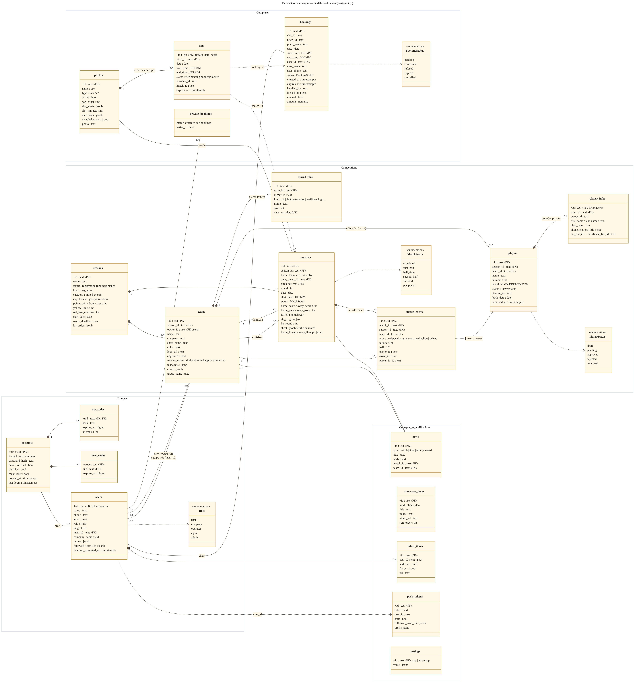

# Base de données — Tunisia Golden League

PostgreSQL 16 · schéma relationnel · diagramme de classes : [`schema.svg`](schema.svg) (source : [`schema.mmd`](schema.mmd))



## Principes

| Règle | Détail |
|---|---|
| Une table par entité | `seasons`, `teams`, `players`, `matches`… au pluriel, colonnes en `snake_case` |
| Types précis | dates `date`, instants `timestamptz`, horaires `text` au format `HH:MM` (vérifié), montants `numeric(10,3)` |
| Valeurs contrôlées | chaque statut / rôle / type n'accepte que ses valeurs (contraintes `CHECK`) |
| Relations garanties | clés étrangères : impossible d'avoir un joueur sans équipe ou un match sans championnat |
| Valeurs imbriquées | feuille de match, contacts, préférences, permissions : `jsonb` |
| Métadonnées | `row_version` (transactions concurrentes), `row_created_at`, `row_updated_at` sur chaque table |
| Documentation intégrée | chaque table a un commentaire (`COMMENT ON`), visible dans Adminer / pgAdmin / DBeaver |

## Tables

| Domaine | Table | Contenu |
|---|---|---|
| Comptes | `accounts` | connexion : e-mail, mot de passe chiffré (bcrypt), e-mail confirmé |
| | `otp_codes`, `reset_codes` | codes d'activation et liens « mot de passe oublié » en cours |
| | `users` | profils : nom, téléphone, rôle, entreprise, permissions |
| Complexe | `pitches` | terrains 6v6 / 7v7, horaires personnalisés |
| | `slots` | créneaux occupés (en attente, réservé, bloqué par un match) |
| | `bookings` | réservations des clients (application ou téléphone) |
| | `private_bookings` | réservations privées de l'administrateur, séries hebdomadaires |
| Compétitions | `seasons` | championnats (Golden / Silver League) et tournois |
| | `teams` | équipes d'entreprise |
| | `players` | joueurs (public) · `player_infos` : données personnelles (privé) |
| | `stored_files` | pièces jointes (CIN, photos, attestations, certificats) |
| | `matches` | matchs, score, tirs au but, forfait, feuille de match |
| | `match_events` | buts, cartons, remplacements |
| Contenus | `news`, `showcase_items` | actualités, carrousel et vidéos de l'accueil |
| Notifications | `inbox_items`, `push_tokens` | notifications dans l'app, téléphones inscrits aux push |
| Réglages | `settings` | `app` (horaires, tarifs, contact), `whatsapp` |
| Technique | `schema_migrations`, `documents` | migrations appliquées · filet de sécurité (voir plus bas) |

## Relations et suppressions

| Quand on supprime… | Effet |
|---|---|
| un championnat | ses équipes, joueurs, matchs et faits de match sont supprimés |
| une équipe | ses joueurs, fiches privées, pièces jointes et matchs sont supprimés ; les comptes liés gardent leur profil (équipe vidée) |
| un joueur | sa fiche privée est supprimée |
| un match | ses faits de match sont supprimés ; les actualités liées restent (lien vidé) |
| un terrain | ses créneaux sont supprimés ; les matchs restent (terrain vidé) |
| un compte | son profil et ses notifications sont supprimés ; ses réservations restent dans l'historique (client vidé, nom conservé) |

Les clés étrangères sont vérifiées **à la fin de chaque transaction** (`DEFERRABLE INITIALLY DEFERRED`) : l'application peut écrire plusieurs données liées dans n'importe quel ordre.

Références volontairement **souples** (sans clé étrangère, documentées en pointillés sur le diagramme) : `slots.booking_id`, `slots.match_id`, `match_events.player_id` (peut valoir `coach:<équipe>`), `push_tokens.user_id`. Ce sont des données d'historique ou techniques qui doivent pouvoir survivre à la donnée pointée.

## Vues de consultation (lecture seule, en français)

`v_utilisateurs` · `v_championnats` · `v_equipes` · `v_joueurs` · `v_matchs` · `v_evenements` · `v_buteurs` · `v_reservations`

```sql
SELECT * FROM v_matchs WHERE championnat = 'Tunisia Golden League' ORDER BY journee, date;
SELECT * FROM v_buteurs ORDER BY buts DESC LIMIT 10;
SELECT * FROM v_reservations WHERE statut = 'pending' ORDER BY date, debut;
SELECT equipe, demande, joueurs_valides, places_utilisees FROM v_equipes;
```

## Évolutivité

**1. Nouveau champ dans l'application, sans rien faire côté base.** Un champ que la base ne connaît pas encore est rangé automatiquement dans la colonne `extra` (jsonb) de sa table. Il est relu, filtrable, et rien n'est perdu.

**2. Faire d'un champ une vraie colonne.** Créez une migration `server/migrations/003_<nom>.sql` :

```sql
ALTER TABLE teams ADD COLUMN sponsor text;
UPDATE teams SET sponsor = extra ->> 'sponsor', extra = extra - 'sponsor' WHERE extra ? 'sponsor';
```

Ajoutez ensuite `sponsor:sponsor:text` dans la table `teams` de `server/src/schema.js`. Au démarrage, le serveur applique les nouvelles migrations, une seule fois chacune et dans l'ordre (table `schema_migrations`). Il vérifie aussi que chaque champ déclaré a bien sa colonne.

**3. Nouvelle collection.** Ses données vont d'abord dans la table générique `documents`. Ensuite, on crée sa table par une migration et on la déclare dans `schema.js`.

## Filets de sécurité

| Où | Quoi |
|---|---|
| `documents` col = `_rejete_<collection>` | données importées refusées (valeur invalide), avec la raison dans `_erreur` |
| `documents` col = `_orphelin_<table>` | lignes importées dont la donnée liée n'existe pas (ex. joueur d'une équipe supprimée) |
| `legacy_docs` | ancien format (une table JSON), conservé après la conversion automatique ; à supprimer quand tout est vérifié : `DROP TABLE legacy_docs;` |

## Fichiers

| Fichier | Rôle |
|---|---|
| `server/migrations/001_schema.sql` | tables, contraintes, index, commentaires |
| `server/migrations/002_vues.sql` | vues de consultation |
| `server/src/schema.js` | correspondance champ de l'application ↔ colonne |
| `server/src/db.js` | lecture / écriture, migrations, conversion de l'ancien format |
